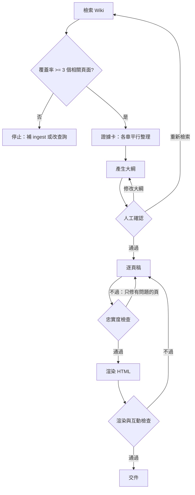

# SKILL.md — 只用 Wiki 產出 HTML 教學簡報

## 目標
使用已 ingest 的 Wiki 知識，生成 8–15 頁適合初學者的 HTML 簡報，所有知識性內容都有可追溯來源。

## Graph

## 檢查關卡
1. 程式：8–15 頁、來源 ID 真實存在、每頁都有來源、可導航、沒有水平溢出。
2. AI 審查：在新對話只提供 HTML 與引用來源，檢查忠實度與涵蓋率。
3. 每輪：只修正檢查報告列出的問題。
4. 停止：全通過／已修 3 輪／相關 Wiki 頁少於 3 頁。

## 實作規則
`scripts/query.py` 用於可重現的本地字詞檢索，不能聲稱它是向量搜尋。人工檢查、瀏覽器渲染測試等需實際執行後才能標示為通過。
