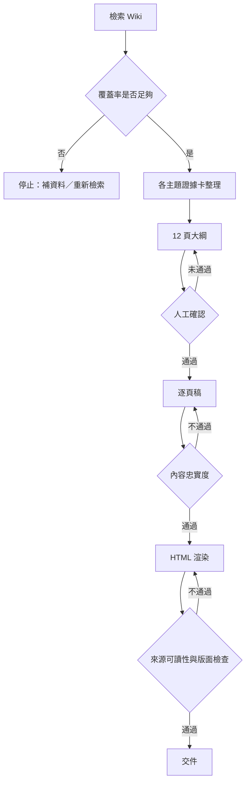

# 第十週作業｜執行、檢查與修正證據

> 紀錄原則：只將實際執行過的項目標為通過；「程式碼存在」不等於「瀏覽器實測通過」。本專案採摘要式 ingest，沒有下載五篇全文或建立向量資料庫。

## A. 先討論、後生成
1. 先確認主題「AI Agents」，規劃定義、核心組件、Agent Loop、Workflow/Graph、風險五章。
2. 登錄五篇官方文件（S01–S05），各建立來源網址、主題標籤、中文轉述摘要與證據卡。
3. 建立 Wiki Markdown 索引、字詞檢索程式、可搜尋 Wiki 網頁。
4. 人工審核 12 頁教學大綱後，才生成 `index.html`。
5. 依 `SKILL.md` 的 Graph 進行來源、忠實度與渲染關卡。

## B. Ingest 紀錄（可稽核清單）
| 來源 | 發布者 | 摘要檔 | 證據卡 | 匯入方式 |
|---|---|---|---|---|
| S01 | OpenAI | [S01](../sources/S01.md) | S01-E1～E3 | 官方文件重點轉述 → Markdown |
| S02 | Anthropic | [S02](../sources/S02.md) | S02-E1～E3 | 官方文件重點轉述 → Markdown |
| S03 | OpenAI Developers | [S03](../sources/S03.md) | S03-E1～E2 | 官方文件重點轉述 → Markdown |
| S04 | Microsoft Learn | [S04](../sources/S04.md) | S04-E1～E2 | 官方文件重點轉述 → Markdown |
| S05 | Microsoft Learn | [S05](../sources/S05.md) | S05-E1～E2 | 官方文件重點轉述 → Markdown |

總計：5 份來源摘要、12 張證據卡、5 個 Wiki 主題章節。原始文件 URL 均在各 `sources/Sxx.md`；完整原文與原始擷取時間未留存，不能把這些摘要稱為「全文 ingest」。`scripts/query.py` 是字詞檢索，不是 LLM 直接檢索或向量搜尋。

## C. Graph 與 Loop

**重複節點**：檢索不足時補資料；大綱不合適時修改；內容不符時只重寫該頁；來源或排版有問題時回到 HTML 導覽／排版。最多 3 輪修正；不足證據時停止，不強行生成。

## D. 實際檢查與問題紀錄
| 輪次 | 已執行的檢查／操作 | 觀察到的結果 | 修正／回退 |
|---|---|---|---|
| 1 | 讀取 GitHub 的 `index.html`、`sources/S01–S05.md`；核對頁數、引用區、證據卡 ID | 12 頁；12/12 頁有引用；5 來源、12 個 ID；來源 ID 無缺漏 | 靜態結構通過，仍需瀏覽器驗證 |
| 2 | 使用者在瀏覽器點擊來源並回報截圖 | 導向 `sources/S03.md`，顯示 Markdown 原始文字；證明「有引用」不等於「引用可讀」 | 新增 `wiki.html`，並將簡報來源改成 `wiki.html#Sxx-Ex` |
| 3 | 再次讀取 GitHub 最新 `index.html` 和 `wiki.html`，檢查連結字串 | 12 頁、24 個引用連結均指向 `wiki.html#...`；沒有舊的 `sources/Sxx.md` 連結；12 個證據 ID 均存在 | 原始碼靜態檢查通過；部署快取與瀏覽器實際跳轉尚未重新確認 |

**未驗證**：線上網站的部署時間、12 頁實際翻頁、不同視窗尺寸的文字溢出、搜尋輸入的瀏覽器操作、獨立新對話的 AI 忠實度審核。不能將其標為 PASS。

## E. Wiki → 簡報證據對照
| 頁碼 | 教學主題 | 證據 ID |
|---|---|---|
| 1 | 學習目標 | S01-E1 |
| 2 | 聊天機器人 vs Agent | S01-E1、S02-E1 |
| 3 | 任務示例 | S01-E1、S03-E1 |
| 4 | 核心組件 | S01-E2、S04-E1 |
| 5 | 工具呼叫 | S03-E1、S03-E2 |
| 6 | Agent Loop | S01-E1、S03-E2 |
| 7 | Workflow | S02-E1、S05-E1 |
| 8 | Graph 與回退 | S02-E2、S05-E2 |
| 9 | 平行工作與多 Agent | S02-E3、S05-E1 |
| 10 | 風險 | S01-E3、S03-E2 |
| 11 | 可靠性 | S01-E3、S02-E2 |
| 12 | 知識回顧 | S01-E1、S02-E1、S03-E2 |

## F. 反思
**哪個節點最常出錯？** 目前有明確使用者回報的問題集中在「HTML 引用導覽／渲染檢查」，而不是來源 ID 是否存在。但目前只有一次有截圖的失敗案例，不能宣稱它在統計上最常出錯。

**把檢查往前移到哪裡？** 原本只在最後檢查引用 ID 存在；現在應在「逐頁稿轉成 HTML」時就檢查引用 URL 必須指向人類可閱讀的 Wiki 證據卡，而不是 `.md` 原始檔，並在部署後再測一次。

**是否修改 Graph？** 有。把渲染關卡拆成「產生 HTML 時的引用目標檢查」及「部署後的實際可讀性檢查」。原因是單靠靜態 ID 檢查無法發現使用者閱讀體驗問題。

## G. 提交前待人工完成
- [ ] 打開線上 `wiki.html`，實測搜尋及 `#S03-E1` 跳轉。
- [ ] 在桌面與手機尺寸檢查全部 12 頁是否溢出。
- [ ] 在新對話提供 Wiki 摘要與簡報，獨立審核忠實度。
- [ ] 將上述結果（PASS／FAIL 與截圖）補進本檔，不可猜測。
